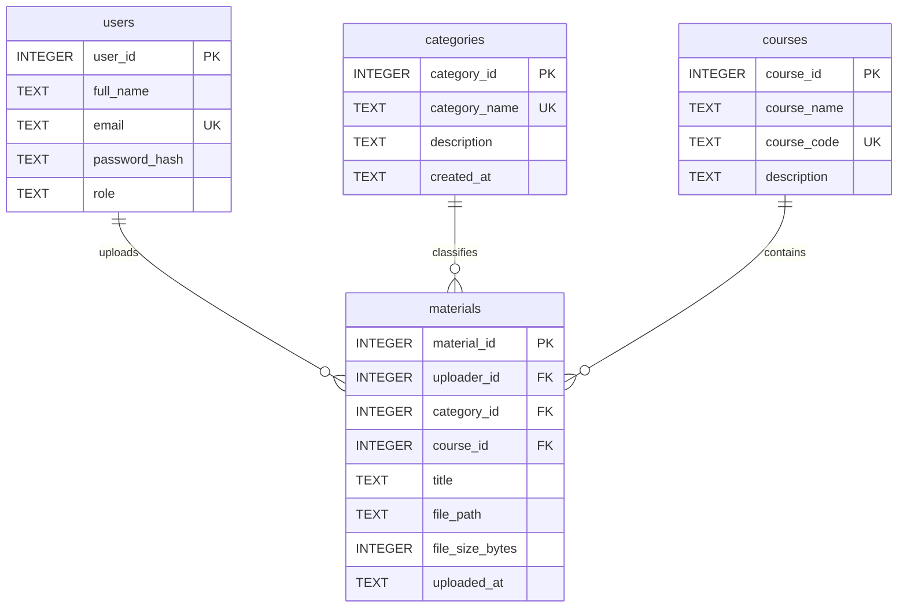

# Initial entity relationship diagram

Each material belongs to one user, category and course; each of those can have many materials. Separate tables avoid repeating user, category and course details in every material, reducing duplication and inconsistent updates. The database holds file metadata and paths, not file blobs. `password_hash` is reserved for future authentication. Application logic must enforce authorization; a foreign key alone cannot establish that an uploader is authenticated. SQLite foreign key enforcement must be enabled on every connection.
