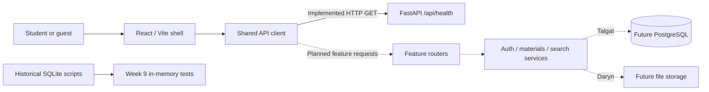

# Architecture

The implemented path is React ? centralized HTTP client ? FastAPI /api/health. PostgreSQL and file storage are future services. Week 9 SQLite remains an isolated prototype exercised by existing tests.

Solid arrows describe current behavior; dashed arrows describe planned integration. Health never claims database readiness. Configuration is centralized in backend/app/core/config.py. HTTP errors use a shared envelope; /docs describes only mounted routes.

Planned workflow: guest browses/searches; student registers/logs in, chooses title/category (course selection requires approval), uploads a bounded file, then others discover/download it. Server authenticates uploads and derives uploader_id; it validates actual bytes and stores metadata only with coordinated file-failure cleanup. Database rows store paths and metadata, not file blobs. Neither database transactions nor foreign keys enforce the whole workflow alone.

Anuar maintains boundaries and contracts. Talgat supplies models, sessions, migrations, auth and persistence. Daryn supplies storage/search/download services. Alibek adds UI under features/ and translations under locales/, calling the shared client. Arnur adds admin behavior and negative/integration tests. New routers register through api/router.py and public schemas live in schemas/. Deployment, backups/restoration, production error logging and performance checks are future work.
